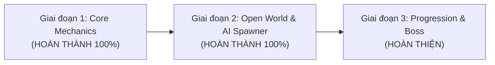

# ⚔️ RPG DUNGEON SURVIVOR 2D - ĐỒ ÁN MÔN HỌC PRU213

> **Môn học:** PRU213 - 2D Game Development with Unity  
> **Sinh viên thực hiện:** Châu Vương Hoàng  
> **Mã số sinh viên (MSSV):** DE180551  
> **GitHub Repository:** [RPG_Game_PRU213](https://github.com/de180551chauvuonghoang-svg/RPG_Game_PRU213)  
> **Nền tảng:** Unity 6 (6000.3.23f1) - C#  

---

## 🎯 GIỚI THIỆU TỔNG QUAN ĐỒ ÁN
**RPG Dungeon Survivor 2D** là một tựa game nhập vai hành động 2D góc nhìn trên xuống thế giới mở vô tận (Top-Down Infinite Open-World Roguelike RPG). Người chơi vào vai một Hiệp Sĩ Cổ Đại (Ancient Knight) sử dụng Gậy Phép Hỏa Long để chiến đấu, né tránh và sinh tồn trước các đợt quái vật hung hãn (Slime Địa Ngục, Xương Ma Ám, Quỷ Dung Nham). Càng đi xa, thế giới mở càng mở rộng vô tận theo bước chân của người chơi, kèm theo hệ thống đợt quái dồn dập và giao diện HUD hiển thị Điểm Số, Số mạng tiêu diệt, Thời gian sinh tồn và Thanh máu mượt mà.

Dự án được thiết kế chuyên sâu theo chuẩn kiến trúc hướng đối tượng (OOP), các mẫu thiết kế phần mềm (**Design Patterns**) và nguyên lý **Clean Architecture** để đáp ứng toàn diện tiêu chí đánh giá và chấm điểm của giảng viên.

---

## 🌟 ĐẶC TÍNH KỸ THUẬT & DESIGN PATTERNS ÁP DỤNG

1. **Procedural Infinite Chunk Generation (`InfiniteWorldManager`):**
   - Thế giới mở vô tận chia thành các ô Chunk (16x16 mét). Người chơi đi tới đâu hầm ngục sinh ra tới đó xung quanh người chơi và tự động thu hồi các vùng đất ở quá xa để tối ưu RAM, giữ FPS luôn ổn định 60 - 120 FPS.
2. **Finite State Machine AI (`EnemyController`):**
   - Quái vật tự động tìm mục tiêu (`Player`), bám đuổi theo hướng vector chuẩn hóa, tự lật Sprite và kích hoạt sát thương va chạm qua `DamageOnContact`.
3. **Dynamic Wave Spawner (`EnemySpawner`):**
   - Sinh quái liên tục ở ngoài viền màn hình theo bán kính 14 - 20 đơn vị, tự động tăng tần suất và số lượng quái theo thời gian sinh tồn (Difficulty Scaling).
4. **Component-Based Architecture:**
   - Phân tách độc lập: `PlayerController`, `PlayerCombat`, `HealthComponent`, `EnemyController`.
5. **Interface Abstraction (`IDamageable`):**
   - Bất kỳ đối tượng nào (Player, Enemy, Boss) mang `IDamageable` đều có thể nhận sát thương và lực nảy lùi (`Knockback`).
6. **Object Pooling Pattern (`ObjectPooler`):**
   - Tái sử dụng các viên đạn ma thuật và hiệu ứng để triệt tiêu Garbage Collection spike.
7. **Observer Pattern (C# Events / Actions):**
   - `GameManager` phát sự kiện `OnScoreChanged`, `OnKillCountChanged`, `OnSurvivalTimeChanged`, `OnGameStateChanged` đến `GameUIManager` để cập nhật giao diện thời gian thực mà không bị ràng buộc phụ thuộc (Decoupling).

---

## 📅 LỘ TRÌNH THỰC HIỆN 3 GIAI ĐOẠN ĐÁNH GIÁ (MILESTONES)

### ✅ GIAI ĐOẠN 1: Core Mechanics & Player Framework (Đã hoàn thành 100%)
- [x] Di chuyển 8 hướng mượt mà với `Rigidbody2D`, tự động chuẩn hóa vector.
- [x] Cơ chế **Dash (Lướt né đòn)** kèm thời gian miễn nhiễm sát thương (I-Frames).
- [x] Nhân vật và gậy phép tự động xoay 360 độ theo con trỏ chuột.
- [x] Cơ chế bắn đạn cầu lửa ma thuật liên thanh có độ giật ngẫu nhiên (`Spread Angle`), tự động lọc va chạm.
- [x] Hệ thống Máu (`HealthComponent`), Lực nảy lùi (`Knockback`) và Hiệu ứng nháy đỏ trúng đòn (`HitFlash`).
- [x] Camera 2D mượt mà (`SmoothDamp`) tích hợp cơ chế `Look-Ahead` nhìn về hướng chuột.

### ✅ GIAI ĐOẠN 2: Open World, AI Quái, Spawner & HUD Điểm Số (Đã hoàn thành 100%)
- [x] **Thế Giới Mở Vô Tận (Infinite World Generation):** Đi tới đâu bản đồ tự sinh sàn đá hầm ngục tới đó, tự giải phóng vùng đất ở xa.
- [x] **AI Quái Vật Đa Dạng:**
  - *Slime Địa Ngục:* Tốc độ nhanh (3.6), máu vừa (70 HP), 100 điểm.
  - *Xương Ma Ám:* Tốc độ vừa (2.7), máu trâu (120 HP), 250 điểm.
  - *Quỷ Dung Nham:* Tốc độ chậm (2.1), siêu trâu (220 HP), sát thương lớn (25 dmg), 500 điểm.
- [x] **Dynamic Enemy Spawner:** Sinh quái dồn dập xung quanh ngoài màn hình với số lượng tăng dần theo thời gian.
- [x] **Giao Diện HUD Thời Gian Thực:**
  - Điểm số (Score) nhảy số vàng kim khi tiêu diệt quái.
  - Số quái đã tiêu diệt (Kills Count).
  - Đồng hồ đếm thời gian sinh tồn (Survival Timer).
  - Thanh máu động của Hiệp Sĩ (Health Bar kèm text HP).
  - Màn hình Game Over khi tử trận.

### ⏳ GIAI ĐOẠN 3: Progression, Boss Fight & Polishing (Giai đoạn hoàn thiện)
- [ ] Hệ thống nâng cấp kỹ năng khi lên cấp: Chọn 1 trong 3 thẻ bài kỹ năng ngẫu nhiên (Roguelike Card Upgrades).
- [ ] Trùm cuối (Boss) xuất hiện với 3 Phase chiêu thức: Bắn chùm đạn cánh quạt, Dash càn quét, Triệu hồi quái đệ.
- [ ] Hệ thống Lưu trữ điểm cao (`SaveManager`) và Âm thanh SFX/BGM.
- [ ] Tối ưu hóa ánh sáng 2D URP và Đóng gói Build game file chạy độc lập `.exe`.

---

## 🎮 HỆ THỐNG PHÍM ĐIỀU KHIỂN (CONTROLS)

| Phím | Chức năng |
| :--- | :--- |
| **W, A, S, D** | Di chuyển Hiệp Sĩ 8 hướng khắp thế giới mở |
| **Con trỏ chuột (Mouse)** | Xoay hướng nhìn và ngắm gậy phép 360 độ |
| **Giữ Chuột Trái** hoặc **Phím J / K** | Bắn đạn cầu lửa ma thuật liên thanh |
| **Space** hoặc **Chuột phải** | Lướt né đòn (**Dash**) kèm trạng thái bất tử ngắn |
| **Escape** hoặc **P** | Tạm dừng trò chơi (Pause / Resume) |
