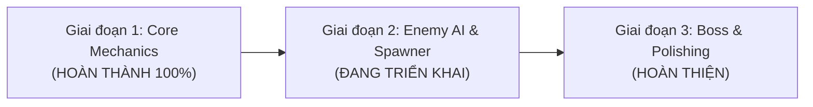

# ⚔️ RPG DUNGEON SURVIVOR 2D - ĐỒ ÁN MÔN HỌC PRU213

> **Môn học:** PRU213 - 2D Game Development with Unity  
> **Sinh viên thực hiện:** Châu Vương Hoàng  
> **Mã số sinh viên (MSSV):** DE180551  
> **GitHub Repository:** [RPG_Game_PRU213](https://github.com/de180551chauvuonghoang-svg/RPG_Game_PRU213)  
> **Nền tảng:** Unity 6 (6000.3.23f1) - C#  

---

## 🎯 GIỚI THIỆU TỔNG QUAN ĐỒ ÁN
**RPG Dungeon Survivor 2D** là một tựa game nhập vai hành động 2D góc nhìn trên xuống (Top-Down Roguelike Action RPG). Người chơi vào vai một Hiệp Sĩ Cổ Đại (Ancient Knight) sử dụng Gậy Phép Hỏa Long để chiến đấu, né tránh và sinh tồn trước các đợt quái vật ma quái (Slime Địa Ngục, Xương Ma Ám, Quỷ Dung Nham) trong hầm ngục tăm tối.

Dự án được thiết kế chuyên sâu theo chuẩn kiến trúc hướng đối tượng (OOP), các mẫu thiết kế phần mềm (**Design Patterns**) và nguyên lý **Clean Architecture** để đáp ứng toàn diện tiêu chí đánh giá và chấm điểm của giảng viên.

---

## 🌟 ĐẶC TÍNH KỸ THUẬT & DESIGN PATTERNS ÁP DỤNG

1. **Component-Based Architecture (Kiến trúc hướng thành phần):**
   - Phân tách độc lập: `PlayerController` (di chuyển & dash), `PlayerCombat` (ngắm bắn & vũ khí), `HealthComponent` (quản lý máu & sát thương).
2. **Interface Abstraction (`IDamageable`):**
   - Áp dụng nguyên lý Đa hình (Polymorphism) và Interface Segregation. Bất kỳ đối tượng nào (Player, Enemy, Boss, Vật cản) mang `IDamageable` đều có thể nhận sát thương và lực nảy lùi (`Knockback`).
3. **Object Pooling Pattern (`ObjectPooler`):**
   - Tái sử dụng các viên đạn ma thuật và hiệu ứng va chạm để triệt tiêu việc cấp phát/giải phóng bộ nhớ liên tục (`Instantiate`/`Destroy`), ngăn ngừa hiện tượng tụt FPS do Garbage Collector.
4. **Data-Driven Design (`ScriptableObject`):**
   - Sử dụng `WeaponData` để lưu trữ và cấu hình các chỉ số vũ khí (Damage, Speed, Spread, FireRate) tách biệt hoàn toàn với logic mã nguồn.
5. **Observer Pattern (C# Events / Actions):**
   - Các sự kiện `OnHealthChanged`, `OnDamageTaken`, `OnGameStateChanged` giúp tách rời liên kết (Decoupling) giữa hệ thống Combat với Giao diện (UI) và Âm thanh.
6. **Cross-Input Compatibility (`GameInput`):**
   - Tương thích 100% với cả **Unity 6 New Input System** (`UnityEngine.InputSystem`) lẫn Legacy Input.

---

## 📅 LỘ TRÌNH THỰC HIỆN 3 GIAI ĐOẠN ĐÁNH GIÁ (MILESTONES)



### ✅ GIAI ĐOẠN 1: Core Mechanics & Player Framework (Đã hoàn thành)
- [x] Di chuyển 8 hướng mượt mà với `Rigidbody2D`, tự động chuẩn hóa vector tránh lỗi đi chéo nhanh hơn đi thẳng.
- [x] Cơ chế **Dash (Lướt né đòn)** kèm thời gian miễn nhiễm sát thương (I-Frames).
- [x] Nhân vật và gậy phép tự động xoay 360 độ theo con trỏ chuột.
- [x] Cơ chế bắn đạn cầu lửa liên thanh có độ giật ngẫu nhiên (`Spread Angle`), tự động lọc va chạm không tự trúng người chơi.
- [x] Hệ thống Máu (`HealthComponent`), Lực nảy lùi (`Knockback`) và Hiệu ứng nháy đỏ trúng đòn (`HitFlash`).
- [x] Camera 2D mượt mà (`SmoothDamp`) tích hợp cơ chế `Look-Ahead` nhìn về hướng chuột.
- [x] Thiết kế đồ họa RPG Pixel Art: Hiệp Sĩ, Slime Địa Ngục, Xương Ma, Quỷ Lửa, Sàn đá hầm ngục.

### ⏳ GIAI ĐOẠN 2: Enemy AI, Wave Spawner & Item Drops (Đang triển khai)
- [ ] AI Quái cận chiến (`MeleeEnemy`) tự tìm đường, bám đuổi Player và tấn công khi vào tầm.
- [ ] AI Quái bắn xa (`RangedEnemy`) giữ khoảng cách an toàn (Kiting) và ngắm bắn Player.
- [ ] Hệ thống Spawner sinh quái theo từng đợt (Wave System) với độ khó tăng dần theo thời gian sinh tồn.
- [ ] Rớt vật phẩm: Ngọc kinh nghiệm (Exp Gem), Bình hồi máu, Tiền vàng khi quái bị tiêu diệt.

### ⏳ GIAI ĐOẠN 3: Progression, Boss Fight & Polishing (Hoàn thiện đồ án)
- [ ] Hệ thống nâng cấp kỹ năng khi lên cấp: Chọn 1 trong 3 thẻ bài kỹ năng ngẫu nhiên (Roguelike Card Upgrades).
- [ ] Trùm cuối (Boss) xuất hiện với 3 Phase chiêu thức: Bắn chùm đạn cánh quạt, Dash càn quét, Triệu hồi quái đệ.
- [ ] Giao diện HUD hoàn chỉnh: Thanh máu mượt (Smooth HP bar), Số đợt quái, Điểm số, Menu Tạm dừng, Màn hình Game Over & Chiến thắng.
- [ ] Hệ thống Lưu trữ điểm cao (`SaveManager`) và Âm thanh SFX/BGM.
- [ ] Đóng gói và Build game file chạy độc lập `.exe`.

---

## 🎮 HỆ THỐNG PHÍM ĐIỀU KHIỂN (CONTROLS)

| Phím | Chức năng |
| :--- | :--- |
| **W, A, S, D** | Di chuyển Hiệp Sĩ 8 hướng |
| **Con trỏ chuột (Mouse)** | Xoay hướng nhìn và ngắm gậy phép 360 độ |
| **Giữ Chuột Trái** hoặc **Phím J / K** | Bắn đạn cầu lửa ma thuật liên thanh |
| **Space** hoặc **Chuột phải** | Lướt né đòn (**Dash**) kèm trạng thái bất tử ngắn |
| **Escape** hoặc **P** | Tạm dừng trò chơi (Pause / Resume) |

---

## 📂 CẤU TRÚC DỰ ÁN & MÃ NGUỒN

```
Assets/
├── Editor/
│   ├── AutoSceneSetup.cs       # Script tự động dựng Scene 1-click
│   └── RpgAssetGenerator.cs    # Script tự động vẽ và gán Sprite RPG Pixel Art
├── Prefabs/
│   └── Bullet.prefab           # Prefab cầu lửa ma pháp tích hợp Object Pooling
├── Data/
│   └── PistolData.asset        # Dữ liệu vũ khí ScriptableObject
├── Sprites/                    # Toàn bộ Sprite RPG (Hiệp Sĩ, Quái, Đạn, Sàn đá)
└── Scripts/
    ├── Camera/
    │   └── CameraFollow2D.cs   # Camera mượt mà có look-ahead
    ├── Combat/
    │   ├── IDamageable.cs      # Interface trừu tượng hệ thống sát thương
    │   ├── HealthComponent.cs  # Quản lý máu, i-frames, knockback
    │   ├── HitFlash.cs         # Hiệu ứng nháy đỏ khi nhận đòn
    │   ├── Projectile.cs       # Đạn bay, va chạm, gây sát thương
    │   └── DamageOnContact.cs  # Sát thương va chạm (quái / bẫy)
    ├── Core/
    │   ├── GameInput.cs        # Xử lý input tương thích Unity 6
    │   ├── GameManager.cs      # Quản lý vòng lặp game, điểm số, pause
    │   └── ObjectPooler.cs     # Design Pattern Object Pool
    ├── Player/
    │   ├── PlayerController.cs # Di chuyển 8 hướng, dash né đòn
    │   └── PlayerCombat.cs     # Ngắm bắn chuột, nạp đạn, self-healing
    └── ScriptableObjects/
        └── WeaponData.cs       # Định nghĩa ScriptableObject vũ khí
```
